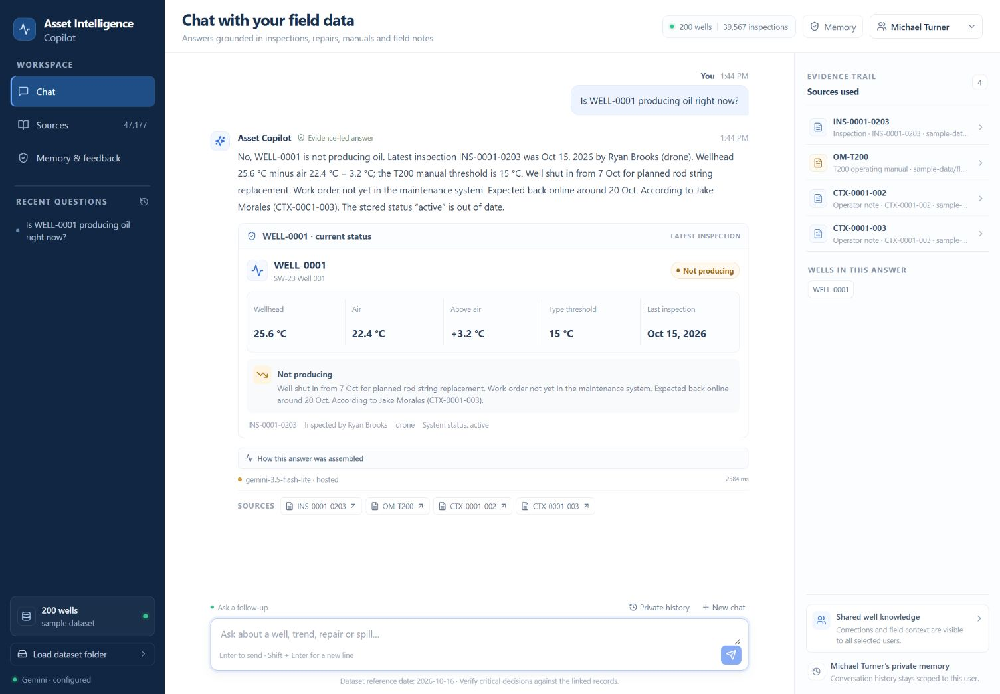
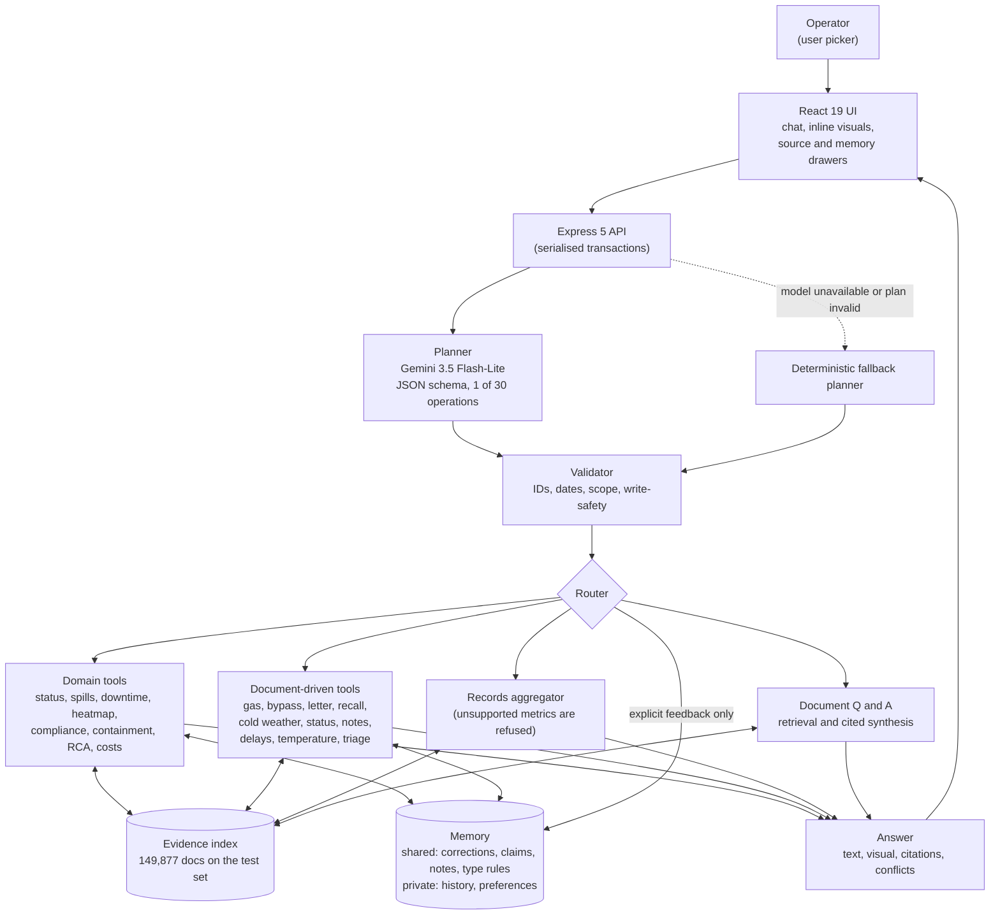
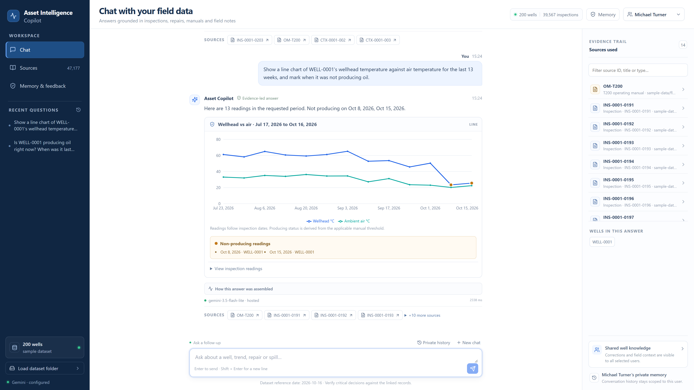
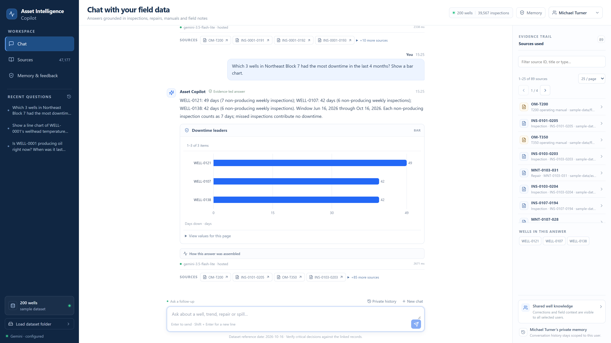
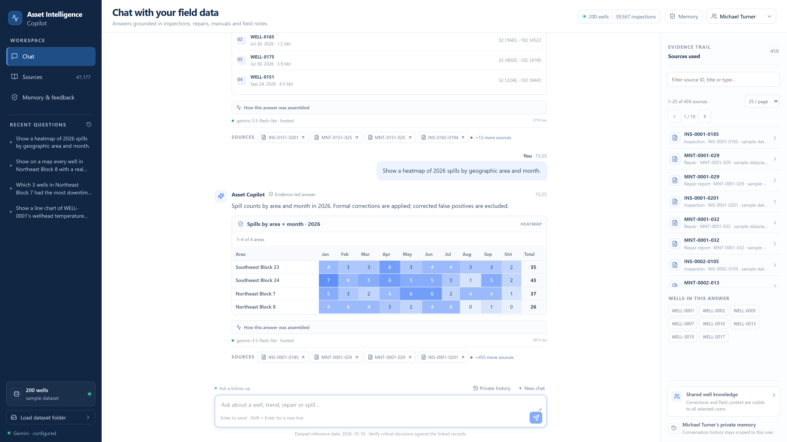
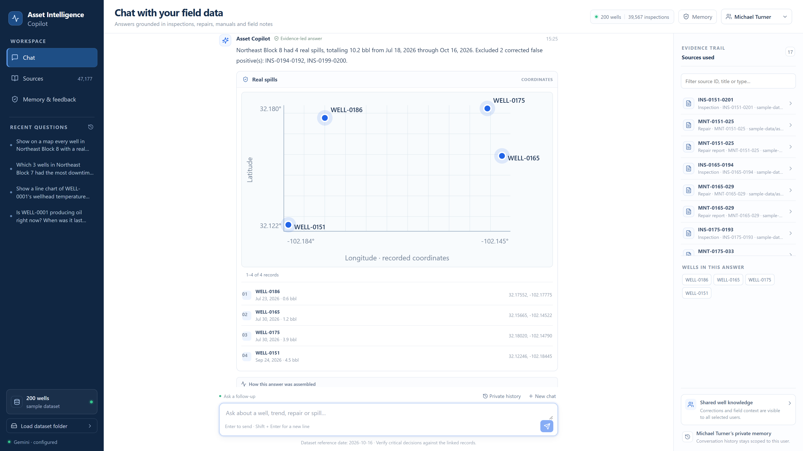
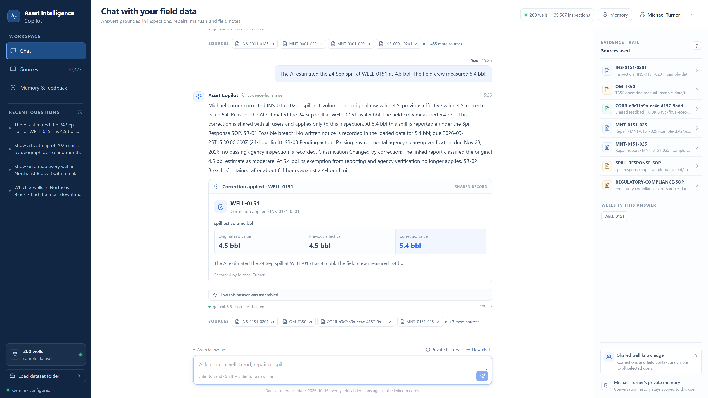
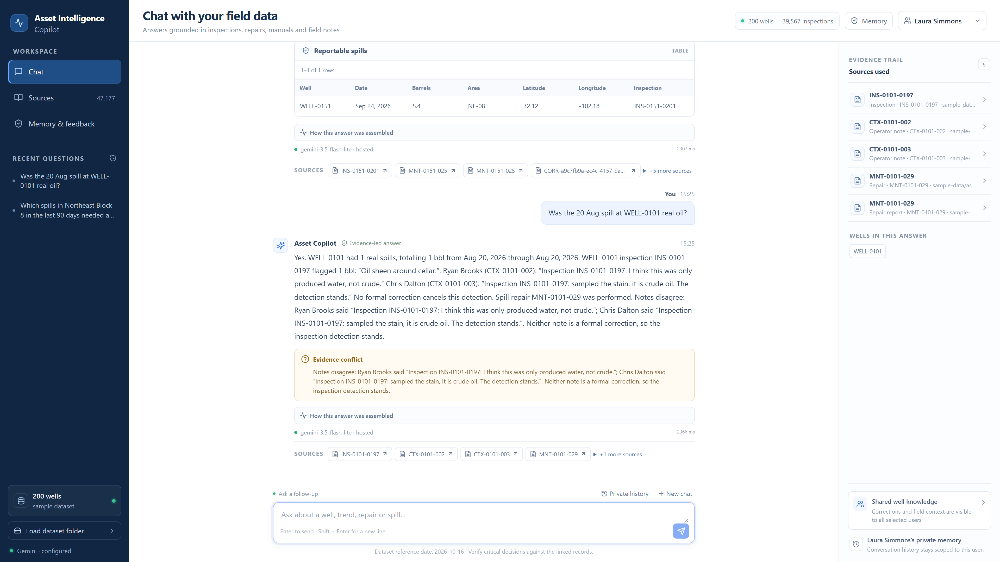

<div align="center">

# Asset Intelligence Copilot

### Ask your oil field anything. Get the answer with its evidence attached.

[](app/package.json)
[](app/package.json)
[](app/package.json)
[](#-models-and-cost)
[](#-outcome-and-benchmarks)
[](LICENSE)

**FlytBase AHC SWE Hackathon · 17 Oct 2026 · built by [Arnav Bule](https://github.com/GODOSTROYER)**

**[🎬 Demo video (4:58)](https://drive.google.com/file/d/1KwvtZFQxvvZBo5SuvqWYeBQuoQAiOWl1/view?usp=sharing) · [📄 Report (PDF)](https://drive.google.com/file/d/11CjfCpPdzDSVMne5zPIL03zHPk6Ji_zO/view?usp=sharing) · [🌐 Live showcase](https://asset-intelligence-copilot-iota.vercel.app) · [📋 All 21 final answers](submission/final-run/FINAL_ANSWERS.md)**



</div>

---

## Introduction

An oil field produces data everywhere: weekly drone inspections, repair histories, regulator events, operator notes, long manuals and SOPs. Today a question as simple as *"is this well actually producing?"* means digging through several systems, so a well that has quietly stopped, or started leaking, can go unnoticed for weeks.

**Asset Intelligence Copilot** is a chat assistant that operators can simply ask. A language model turns the question into **one typed, validated operation**; deterministic code then computes every number, table, citation and conflict from the loaded records and documents. Answers come back as text plus the right inline visual, with the source record IDs attached, and the system remembers corrections, notes and unconfirmed claims at two levels: shared across users, and private per user.

> **The model plans, code calculates.** The LLM never does arithmetic on domain data and never writes memory on its own.

This was built for the FlytBase [Asset Intelligence challenge](https://github.com/FlytBaseAILabs/flytbase-ahc-swe-asset-intelligence-dataset) (problem statement, sample dataset and the 600-well test dataset live in FlytBase's repository and are not redistributed here).

## Accomplishments

- **All 11 final questions match an independent oracle** computed straight from the raw files. Q7 is a ranking judgement: the crew picks match the oracle's set and the order is a judgement call.
- **Honest refusals where the data cannot answer:** no reservoir-pressure map (no pressure data exists) and no "best producer" (no production volumes exist). It lists what does exist and offers clearly labelled proxies instead of inventing numbers.
- **Rules are read from the documents at run time**, not hard-coded: OPS-1 gas-response deadlines (24 h, then 12 h from 1 Jan 2027), OPS-3 status precedence, OPS-5 cold weather, MOC bypass approvals and extensions, recall model and lots, the regulator letter's scope, per-type production thresholds (T200 / T350 / T500).
- **Exact answers on the hard compliance questions:** gas reports 17 Met / 9 Missed; bypasses Allowed / Expired / Not approved by MOC memo; regulator-letter spills split 3 compliant / 3 not.
- **Two-level memory that survives adversarial multi-user turns:** unconfirmed, attributed claims that never overwrite records; private preferences that never leak to another user.
- **Scales to the test set:** 600 wells, 7 areas, **149,877 evidence documents** indexed in about 4 s; hosted answers in seconds.
- **Offline verification:** 25/25 acceptance scenarios, 109/109 independent domain-stress cases, 27 provider checks, plus adversarial write-routing probes (reproduced while preparing this repo: see [Verification](#-verification)).
- **Generative UI:** status card, table, line, bar (incl. stacked), map and heatmap, picked per answer or on request.
- **Honest engineering story:** our first live run on the test set scored **0/11**; this README tells you why and how it was fixed.

## Outcome and benchmarks

### Scorecard: the 11 final questions on the 600-well test set

Test dataset: 600 wells, 7 areas, 125,198 inspections, 17,415 repairs; "today" = 15 Jan 2027; questions asked in order, exactly as written (21 turns). "Oracle" is the expected answer computed independently from the raw files ([`submission/final-run/oracle/`](submission/final-run/oracle)).

| Q | Topic | Result | What the copilot answered |
|---|---|:---:|---|
| 1 | Reservoir pressure map | ✅ | **Declined**: no reservoir/tubing/casing/wellhead pressure exists. Listed what does exist (flowline test pressures 188 to 400 psi in 2,432 repair reports; valueless separator alarms) and what data would be needed. |
| 2 | Best producer in 2026 | ✅ | **No production volumes exist**, so no winner. Labelled proxy (producing weeks by the type rule): 52 wells tie at 53/53; downtime tie-break gives WELL-0147 and WELL-0315. |
| 3 | Gas reports vs OPS-1 deadline | ✅ exact | 26 reports: **17 Met, 9 Missed**, full table with record IDs and hours to response. |
| 4 | Temporary flowline bypasses | ✅ exact | WELL-0248 **Allowed** (MOC extended), WELL-0249 **Expired**, WELL-0405 **Not approved**; past violations WELL-0087, 0158, 0561. |
| 5 | Regulator's letter | ✅ exact | Scope: NE Blocks 7-8, at least 5 bbl, since 1 Jun 2026. 6 spills: **3 compliant, 3 not** (no "soil samples sent to the lab"). |
| 6 | Which status is right | ✅ | 17 disagreeing wells: ten where a newer note wins, seven where a newer inspection wins; "Producing (unconfirmed)" where a restart has an open job. |
| 7 | What operators are hearing (2 turns) | ✅ | Printed risk score over 175 noted wells: an overdue mandated check (T500 §5) outranks a not-yet-due one, plus recall, decline and repeat failures. All must-have wells are in the top 10. Crew picks **0263, 0219, 0202** (the oracle's set); 0202 is paired with 0219 because one trip covers the same block. |
| 8 | Who told you that (5 turns) | ✅ | Unconfirmed claim recorded and attributed; private preference stays private; second-hand claim recorded but does not remove a well; sources stated every turn. |
| 9 | Six topics, one session (6 turns) | ✅ x6 | Pumps, team lead, cold-weather SOP, "no H2S reading recorded", pumps not producing, and turn 6 **triage across the 57 wells discussed → WELL-0332 first** (unanswered gas report, unexplained stop), then 0160 and 0263. |
| 10 | What are we waiting on | ✅ | 634 jobs: **Contractors 33%, Crews 27%, Weather 22%, Parts 18%**, median about 9 extra days. **Southeast Block 31 stands out** for contractor waits (43% of 40 jobs vs 33%; median 14 vs 9 extra days), with a small-sample caveat (chi-square p about 0.92). Stacked bar by area. |
| 11 | Hotter wells | ✅ | **No region genuinely runs hotter.** SE-31 only looks hottest because 58% of its wells are T500; the type-adjusted delta is within +/-0.05 C. |

Of the 21 turns, 19 ran on the hosted Gemini planner and 2 on the deterministic fallback (Q7 t2 and Q9 t3), with identical tool output. Every answer is flagged with its planner status.

### Sample-set benchmarks (200 wells)

| Check | Result |
|---|---|
| Acceptance suite (18 challenge scenarios + unseen variations) | **25 / 25** |
| Independent domain stress (oracle reads raw files, no engine helpers) | **109 / 109** |
| Provider / planner stress checks | **27** |
| Adversarial write-routing probes | questions, quotes, hypotheticals and "don't save" never write |

### Speed and scale

| Metric | Value |
|---|---|
| Load + index, test set | about **4 s** for 600 wells and **149,877** evidence documents |
| Hosted answer latency (final run, 19 of 21 turns hosted) | median about 5 s; fastest 1.6 s; slowest 11 s |
| Provider timeout cap | 25 s, then deterministic fallback |
| Cost | free-tier Gemini keys with app-side rate caps and a 10-minute plan cache |

### The honest journey

```text
first live run on test data  ->  0 / 11   (every turn silently fell back to the rule planner)
   cause 1: planner JSON-schema bound grew with the fleet (600); Gemini rejected it
   cause 2: the 17-operation menu could not express MOC approvals, recall lots,
            note-to-response joins or letter scope
fix: fixed schema bound (validator enforces the real fleet size) + 13 document-driven tools incl. conversation triage
   + scope for fleet questions now comes only from the question, not earlier answers
final run                    ->  11 / 11 vs independent oracles
```

Every run is kept for audit: [`FINAL_ANSWERS.md`](submission/final-run/FINAL_ANSWERS.md) is the final one; the earlier runs were summarised in the final report.

## Architecture



**The model plans, code calculates.** The hosted model has exactly one job: choose one operation (and its scope) from a closed menu of 30, constrained by a JSON schema. Everything after that is ordinary, testable code: the validator rejects unknown wells, areas, dates and fields and lets explicit values in the question override the model's; the tools compute every figure from the evidence index; the answer carries record IDs the UI turns into a source drawer. The model can never invent a number, a citation or a memory write, and if it fails, a deterministic planner answers instead.

## How it works

<details>
<summary><b>1. Data loading and indexing</b></summary>

- At startup, `server/data.ts` reads every JSON/JSONL record (wells, inspections, repairs, regulator events, operator notes, users, areas) and every Markdown document (well-type manuals, SOPs, MOC memos, the supplier recall notice, the regulator letter, free-text repair reports) into one typed **evidence index**: record ID, well, type, source path.
- The loader accepts a dataset root containing `fleet/` and `assets/` (or a parent holding `sample-data/` / `test-data/`). Extra roots can be merged by record ID; a replacement record replaces the whole prior record, and citations keep their originating root and path.
- Optional fields are respected: well-type history (WELL-0010 changed type), late-entered records, data corrections, plugged wells.
- **Production status** is derived, never stored: wellhead minus ambient temperature compared against the threshold in that well type's manual (T200 / T350 / T500). **Downtime** is 7 days per non-producing weekly inspection; a missed inspection adds none.
- The test set loads in about 4 s: 600 wells, 7 areas, 149,877 evidence documents.

</details>

<details>
<summary><b>2. Planner and validator, including write-safety</b></summary>

**Planner.** Gemini 3.5 Flash-Lite receives the question, the reference date, a compact area/user/well-ID context and the asking user's last 5 exchanges. It returns a `QueryPlan` under a JSON schema: an `operation` from a closed enum of 30, plus optional `wellIds`, `areaId`, `from`/`to`, `year`, `topK`, `equipmentKind`, `visual`, and the fields needed for writes. Plans are cached for 10 minutes (the answer is always recomputed).

**Validator** (`validatePlan` in `server/agent.ts`):

- rejects unknown wells, areas, dates, equipment kinds, well types and inspection IDs; checks numeric ranges;
- explicit values in the question win over the model's (a requested year, an explicit date range, "reportable only", a named equipment kind);
- fleet-wide tools take well and area scope only from the question text, never from earlier answers (this fixed the "topic reference" bug);
- year-less past dates never resolve into the future; "my area / my team" resolves from the asking user.

**Write-safety rules.** The five write operations (`correction`, `rule`, `note`, `claim`, `preference`) are special:

1. A write is only allowed when a **rule-based parser** detects explicit declarative feedback in the user's message.
2. The write payload (well, field, value, threshold) comes **only** from that parser, never from the model's plan, so prompt injection or invented IDs in a hosted plan cannot write.
3. Questions, quotations, hypotheticals ("review the assertion that...", "never save this") and analysis requests are routed to read-only operations.
4. If the model proposes a write the parser did not detect, the plan is rejected and the deterministic path answers.

</details>

<details>
<summary><b>3. Tool catalogue: all 30 operations</b></summary>

**Core operations (18)**

| Operation | What it answers |
|---|---|
| `status` | Latest inspection of a well, the manual's temperature rule, corrections, context and conflicts |
| `area_status` | Current non-producing wells (fleet, area, type or explicit wells), with reasons and stale metadata |
| `temperature_history` | Weekly wellhead / ambient temperature chart for a well |
| `spills` | Real spills after formal corrections, optionally by well, area, dates, reportable-only |
| `downtime` | Non-producing weekly inspections x 7 days, for wells and a date window |
| `downtime_ranking` | Wells ranked by inspection-derived downtime |
| `heatmap` | Spill count by area and calendar month |
| `compliance` | Spill reporting, verification, regulator notices, missing documents, deadlines |
| `containment` | Spills with late containment, combining repair reports and SOP rules |
| `rca` | Corrective repair counts by equipment kind, plus manual and type rules |
| `costs` | Exact repair-cost sums for wells and periods (private "we discussed" references resolved from that user's history) |
| `shared_knowledge` | Shared notes and scheduled work for a well, read-only |
| `search` | General document retrieval and grounded synthesis; the fallback for unsupported questions |
| `correction` | **Write.** Replace one inspection field; keeps original value, author, reason, scope |
| `rule` | **Write.** Shared per-well-type equipment threshold |
| `note` | **Write.** Shared field note, attributed |
| `claim` | **Write.** Unconfirmed claim (for example "pump was swapped"), attributed, conflicts shown |
| `preference` | **Write.** Private display preference (sort order, units such as $k) |

**Document-driven tools (12)**, added after the first live run, each in [`app/server/tools/`](app/server/tools)

| Operation | What it answers |
|---|---|
| `gas_response` | Operator gas / H2S notes vs the OPS-1 response deadline; Met / Missed table; reports any measured H2S value or that none is recorded |
| `cold_weather` | What OPS-5 requires and which wells missed the cold-weather check in a period |
| `bypass_compliance` | Temporary flowline bypasses in place now and in the past vs MOC approval and expiry: Allowed / Expired / Not approved |
| `regulator_letter` | Which spills a regulator letter covers (areas, volume, date window) and which are non-compliant |
| `recalled_pumps` | Wells whose installed pump is under supplier recall (model and lots from the notice, installs from repair-report parts lines), cost, status now, last repair, unconfirmed swap claims |
| `team_info` | Who leads a team, how many wells it runs, its areas |
| `status_disagreement` | Wells where the latest inspection and latest status note disagree; real status now by OPS-3 |
| `note_risk` | Recent "sounds wrong" operator notes with no repair since, ranked by a transparent score with warning signs |
| `delay_reasons` | Why wells stay shut in longer than the repair (parts / crews / contractors / weather), share and typical extra days by area |
| `region_temperature` | Raw vs ambient vs type-adjusted temperature by area; tests whether any region truly runs hotter |
| `data_availability` | Asks about metrics that may not exist (pressure, production volume, flow); reports exactly what exists, refuses to invent, offers labelled proxies |
| `triage` | Prioritises across the wells in this conversation: safety > compliance > unexplained production loss > equipment risk |

</details>

<details>
<summary><b>4. Rules read from documents</b></summary>

Deadlines, thresholds and approvals are **parsed from the documents** at run time and every rule is cited in the answer. That is why new data and new SOP revisions did not need new code paths.

| Rule | Source | How it is used |
|---|---|---|
| **OPS-1** gas response | operations SOP | 24 h deadline, 12 h from 1 Jan 2027; what counts as a response (a drone flight does not) |
| **OPS-3** status precedence | operations SOP | The more recent evidence wins between inspection and operator notes |
| **OPS-5** cold weather | operations SOP | Temperature threshold, season, required job, allowed days |
| **MOC memos** | management-of-change documents | Bypass approval window, extensions (MOC-2026-031 extended by 044), expiry |
| **Recall notice** | supplier recall (SOP-type doc) | Recalled pump model **and lots**; matched to installed serial/lot in repair reports |
| **Regulator letter** | State Oil & Gas Commission | Which area/blocks, minimum volume, date window, and the conditions for compliance (clean-up job, lab samples, timing) |
| **Production thresholds** | well-type manuals | T200 / T350 / T500 decide producing vs not, per well type and per date (type history) |

</details>

<details>
<summary><b>5. Memory: shared vs private</b></summary>

| Level | What is stored | Behaviour |
|---|---|---|
| **Shared** | **Corrections** (original value, new value, author, timestamp, reason, scope) | Applied in every later answer for every user; the original is preserved |
| | **Notes** (with validity dates) | Visible to everyone asking about the well |
| | **Claims** (for example "WELL-0333's pump was swapped") | Kept as **unconfirmed** and attributed; **never overwrites records**; flagged "reported by X, no work order"; second-hand claims are marked as such |
| | **Type rules** | Scoped to one well type and equipment kind, applied only there |
| **Private** | Per-user **history** (last 80 entries) | "The wells we discussed" resolves from the asking user's history only |
| | **Display preferences** (sort order, $k) | Applied only for that user; another user's answer is unchanged |

State is persisted to a local `state.json` with **atomic saves**: each chat clones the state, runs the agent, writes a temp file, renames it, and only then swaps the in-memory state, so a failed turn leaves state untouched.

</details>

<details>
<summary><b>6. Conflict handling and honest refusals</b></summary>

- **Conflicts are shown, not resolved silently:** claim vs record, note vs inspection, notes that disagree with each other, second-hand reports. The answer carries a `conflicts` list and the UI renders an "Evidence conflict" callout.
- **Honest refusals:** if the data cannot answer, the copilot says so and lists exactly what it scanned. `data_availability` checks field names and document text for pressure, production volume and flow before answering, and offers labelled proxies only when they are meaningful.
- **Incomplete evidence is disclosed:** containment and compliance answers state counts of unresolved timings, missing reports and unknown volumes.
- **Cited synthesis is validated:** in document Q&A, each text segment must cite selected passages; unsupported numeric tokens and record IDs are rejected.

</details>

<details>
<summary><b>7. Generative UI visuals</b></summary>

The answer is generated for the question, not chosen from fixed screens. The tool returns a typed visual, or the user names one ("show it as a table").

| Visual | Used for |
|---|---|
| **Status card** | One well: temperatures, threshold, verdict, conflicts |
| **Table** | Lists such as gas reports, bypasses, regulator-letter spills, recalled pumps |
| **Line chart** | Temperature over time |
| **Bar chart** (incl. stacked) | Comparisons, such as delay reasons by area |
| **Map** | Well locations on a local coordinate grid (no external basemap) |
| **Heatmap** | Two dimensions such as area x month spill counts |

<table>
<tr>
<td></td>
<td></td>
<td></td>
</tr>
<tr>
<td></td>
<td></td>
<td></td>
</tr>
</table>

</details>

<details>
<summary><b>8. Resilience and fallback</b></summary>

- If the hosted planner times out, errors, or returns an invalid plan, a **deterministic planner** (`inferPlan`) answers instead, and the answer is flagged `fallback` with the reason.
- Provider calls run through app-side per-key buckets (requests/min, tokens/min, requests/day), a 25 s timeout, and at most two attempts; provider error bodies and keys are never sent to the browser.
- Requests are serialised, with a bounded queue (429 beyond 12 pending).
- The API binds to `127.0.0.1` and rejects non-local browser origins.

</details>

<details>
<summary><b>9. Models and cost</b></summary>

- **Gemini 3.5 Flash-Lite** for planning and synthesis: about 2 to 5 s typical per hosted answer on free-tier keys, with app-side rate caps and a 10-minute plan cache. An optional reasoning model (`GEMINI_REASONING_MODEL`) is used only for explicit deep analysis or cross-document comparisons.
- **Gemma 4 test:** tried as a drop-in planner with the same prompt and validator. Every plan that came back was correct, but free-tier capacity errors (429/500/503) and 40 to 60 s latency ruled it out for the live run.
- Because the model only picks an operation and a scope, the prompt is small and the model is cheap; cost does not scale with the amount of data.

</details>

## Final questions walkthrough

Each paragraph: what was asked, what it answered, why it is right. Oracles are in [`submission/final-run/oracle/`](submission/final-run/oracle); verbatim answers in [`FINAL_ANSWERS.md`](submission/final-run/FINAL_ANSWERS.md).

**[Q1](submission/final-run/oracle/Q1.md) · Reservoir pressure.** Asked to map reservoir pressure from "the pressure data". The copilot declined: it scanned 68 field names and 149,877 documents, found no reservoir, tubing, casing or wellhead pressure, listed what does exist (flowline test pressures in repair reports, separator alarms without values), and said what data it would need. It did not fabricate a map from temperature or well type. The oracle's required behaviour is exactly this refusal.

**[Q2](submission/final-run/oracle/Q2.md) · Best producer.** "Which well produced the most oil in 2026?" There are no production volumes, so it would not name a winner. It offered a labelled proxy (producing weeks under each well's type rule) and a downtime tie-break, clearly marked as a proxy.

**[Q3](submission/final-run/oracle/Q3.md) · Gas reports.** For every operator note reporting gas since 1 Nov 2026 it found the first valid response and compared hours-to-response with the OPS-1 deadline (24 h, 12 h from 1 Jan 2027; drone flights do not count). 26 reports, 17 Met, 9 Missed, matching the oracle exactly.

**[Q4](submission/final-run/oracle/Q4.md) · Flowline bypasses.** It reconstructed in/out intervals from notes, joined them to MOC memos including the extension memo, and classified each: Allowed (WELL-0248), Expired (WELL-0249), Not approved (WELL-0405), plus past violations 0087, 0158, 0561.

**[Q5](submission/final-run/oracle/Q5.md) · The regulator's letter.** It parsed the letter's scope (NE Blocks 7 and 8, at least 5 bbl, since 1 Jun 2026), found 6 covered spills, and checked each against the conditions: 3 compliant, 3 not (no soil samples sent to the lab), also flagging timing breaches.

**[Q6](submission/final-run/oracle/Q6.md) · Which status is right.** Across the whole field it compared the latest inspection with the latest shut-in/restart note under OPS-3 (newer evidence wins): 17 wells, with "unconfirmed" where a restart note exists but the job is still in progress, and type history and data corrections applied.

**[Q7](submission/final-run/oracle/Q7.md) · What the operators are hearing.** From 175 wells with abnormal-sound notes it removes those repaired since (12), then ranks the rest with a printed score. An overdue mandated check (T500 manual §5 ESP check) outranks one not yet due; a recalled pump past its deadline, decline length and size, and repeat failures add weight. All of the oracle's must-have wells are in the top 10. Crew dispatch picks **WELL-0263, 0219, 0202**, the oracle's set; 0202 joins 0219 because they share a block, so one trip covers both.

**[Q8](submission/final-run/oracle/Q8.md) · Who told you that.** Five turns across users. Nathan's unconfirmed pump swap is recorded and attributed but the well stays on the list; his sorting/$k preference is private; Robert sees 9 wells with WELL-0333 flagged "reported replaced by Nathan, no work order"; Olivia's second-hand claim about WELL-0577 is recorded but does not remove it; Nathan then gets his four NW wells sorted, in $k. Sources are stated each turn.

**[Q9](submission/final-run/oracle/Q9.md) · One conversation, several topics.** All six turns are correct:
- 9 recalled pumps in 4 areas.
- Nathan Pierce leads Northwest with 150 wells.
- OPS-5 quoted, with the December misses.
- No H2S reading recorded at WELL-0332, and the response deadline missed.
- The pumps not producing, with their last repairs.
- Turn 6 runs the deterministic **triage** tool over the 57 wells discussed and ranks safety > compliance > unexplained production loss > equipment. It puts **WELL-0332 first** (unanswered gas report with no H2S reading, plus a stop nothing explains), then 0160 and 0263.

**[Q10](submission/final-run/oracle/Q10.md) · What are we waiting on.** Classifies 634 jobs by delay reason from the repair reports, using a documented keyword map: Contractors 33%, Crews 27%, Weather 22%, Parts 18%, about 9 extra days. It flags **Southeast Block 31** as standing out for contractor waits (43% of its 40 jobs; median 14 vs 9 extra days). It also states the caveat that, on 40 jobs, this is not statistically significant on its own (chi-square p ≈ 0.92), so it is an operational signal to check. Shares by area, plus a stacked bar.

**[Q11](submission/final-run/oracle/Q11.md) · Hotter wells.** Naive temperatures make SE-31 look hottest, but 58% of its wells are T500 (which run warmer). Ambient is flat and the type-adjusted difference is within +/-0.05 C, so the honest answer is that no region consistently runs hotter.

## Verification

| Layer | What it proves |
|---|---|
| **Independent oracles** | For every final question the expected answer was computed straight from raw files, without the engine's helpers ([`oracle/`](submission/final-run/oracle)). |
| **Offline suites** | [`acceptance.ts`](app/scripts/acceptance.ts) 25/25; [`domain-stress.ts`](app/scripts/domain-stress.ts) 109/109 (oracle reads raw filesystem records); [`data-check.ts`](app/scripts/data-check.ts) 10/10 on loader and import rules; plus engine, provider, visual and live checks. |
| **Adversarial write probes** | Hypotheticals, quoted statements, "never save this", analysis requests and questions never mutate memory; model-proposed writes without a parsed declarative statement are rejected ([`rule-adversarial-check.ts`](app/scripts/rule-adversarial-check.ts), [`import-memory-adversarial-check.ts`](app/scripts/import-memory-adversarial-check.ts)). |
| **Recorded reviews** | [`app/docs/`](app/docs): ACCEPTANCE, DOMAIN_STRESS, PROVIDER_STRESS, ADVERSARIAL_HARDENING, UI_STRESS, REVIEW and more. |

While preparing this repository, `acceptance` (25/25), `domain-stress` (109/109) and `data-check` (10 passed) were re-run from a clean `npm ci` and `tsc --noEmit` was clean.

## Quickstart

Prerequisites: Node.js 20.12+ (uses `process.loadEnvFile`) and a Gemini API key (free tier works). Without a key the app still runs on the deterministic fallback planner.

```bash
# 1. Get the dataset (owned by FlytBase) and this repo side by side
git clone https://github.com/FlytBaseAILabs/flytbase-ahc-swe-asset-intelligence-dataset
git clone https://github.com/GODOSTROYER/asset-intelligence-copilot
cd asset-intelligence-copilot/app

# 2. Install and configure
npm ci
cp .env.example .env.local        # then put your key in GEMINI_API_KEY
npm run dev                       # UI on http://127.0.0.1:5173, API on :4178
```

| Variable | Purpose | Default |
|---|---|---|
| `SAMPLE_DATA_PATH` | Dataset root (`fleet/` + `assets/`); `.env.example` points at the sibling clone's `sample-data` | none |
| `REFERENCE_DATE` | "Today" for the evaluation (`YYYY-MM-DD`) | `2026-10-16` |
| `PORT` | API port | `4178` |
| `COPILOT_STATE_DIR` | Where `state.json` (memory) is written | `app/.local` |
| `GEMINI_API_KEY` / `GEMINI_API_KEYS` | One key, or a comma/JSON list (one app-side bucket each) | none |
| `GEMINI_MODEL` | Planner and synthesis model | `gemini-3.5-flash-lite` |
| `GEMINI_REASONING_MODEL` | Optional model for deep cross-document analysis | unset |
| `GEMINI_RPM` / `GEMINI_TPM` / `GEMINI_RPD` | App-side caps per key | `5` / `20000` / `100` |
| `GEMINI_TIMEOUT_MS` | Provider timeout | `25000` |

**Run on the 600-well test set** (as in the final run):

```bash
SAMPLE_DATA_PATH=../../flytbase-ahc-swe-asset-intelligence-dataset/test-data/dataset \
REFERENCE_DATE=2027-01-15 COPILOT_STATE_DIR=/tmp/copilot-final npm run dev
```

**Production-style run:** `npm run build && npm start` (serves the built UI from the API).

**Run the checks** (from `app/`, with `SAMPLE_DATA_PATH` pointing at the sample dataset; no API key needed):

```bash
npx tsc --noEmit
npx tsx scripts/acceptance.ts       # 25/25
npx tsx scripts/domain-stress.ts    # 109/109
npx tsx scripts/data-check.ts       # loader and import rules
```

Never commit `.env.local`; it is git-ignored.

### Repo layout

```text
.
├── app/                         the copilot
│   ├── server/                  Express API, planner, validator, engine, Gemini client
│   │   └── tools/               13 document-driven tools (incl. triage)
│   ├── src/                     React 19 UI (chat, visuals, drawers)
│   ├── scripts/                 acceptance, stress, adversarial and live checks
│   ├── docs/                    architecture, acceptance, stress and review reports, screenshots
│   └── .env.example
├── submission/
│   ├── FINAL_REPORT.md          the written report (authoritative numbers)
│   ├── report/                  report PDF (if included)
│   └── final-run/               FINAL_ANSWERS.md, oracle/Q1-Q11.md, raw-v2/*.json
└── video/                       HyperFrames project for the demo video
```

## Demo video and report

- **Demo video (4:58):** [Google Drive](https://drive.google.com/file/d/1KwvtZFQxvvZBo5SuvqWYeBQuoQAiOWl1/view?usp=sharing).
  - The first 2 minutes cover the system and its architecture.
  - The next 3 minutes are a real end-to-end scenario recorded in the live app on the 600-well test set: recalled pumps, a first-hand and a second-hand claim kept unconfirmed and attributed, the OPS-1 gas-response audit, and triage.
- **Report (3-page PDF):** [Google Drive](https://drive.google.com/file/d/11CjfCpPdzDSVMne5zPIL03zHPk6Ji_zO/view?usp=sharing), also [`submission/report/FINAL_REPORT.pdf`](submission/report/FINAL_REPORT.pdf) in this repo. The Markdown source is [`submission/FINAL_REPORT.md`](submission/FINAL_REPORT.md).
- **Live showcase:** [asset-intelligence-copilot-iota.vercel.app](https://asset-intelligence-copilot-iota.vercel.app), with the video, report, scorecard and architecture.
- The video is built with HyperFrames from [`video/`](video): storyboard, design spec and HTML compositions. Voice-over audio and rendered output are not in the repo; `cd video && npm run dev` previews the compositions.

## Engineering decisions and trade-offs

| Decision | Why | Cost |
|---|---|---|
| **One typed operation per question** | Auditable, testable, cheap, no model arithmetic | Cross-tool questions need a dedicated tool (we added `triage` for Q9 t6); general multi-step plans are next |
| **Rules parsed from documents** | New SOP clauses, MOC extensions and thresholds work without code changes | Parsers must tolerate wording variety; each tool has its own |
| **Write payloads only from a rule-based parser** | Prompt injection cannot write memory | Unusual phrasings of feedback may need a rephrase |
| **Claims stay unconfirmed** | Never silently overwrite records with hearsay | A user must confirm or reject (UI for that is future work) |
| **Refuse instead of guess** | Q1 and Q2 have no data; inventing it would be worse than refusing | Less "helpful" on paper, more correct |
| **Fixed schema bound, validator enforces scale** | Gemini rejected a 600-element schema bound | Validation lives in code, not the schema |
| **Deterministic fallback planner** | The demo still answers when the provider is down | Fallback is less flexible (2 of 21 final turns used it) |
| **Local-first, serialised API** | Simple, safe state handling with atomic saves | Single-process demo, not multi-tenant |

**Known limits.** The user picker is a demo switcher, not authentication. The map is a local coordinate grid with no external basemap. No inspection images are provided or analysed. The data is synthetic.

## What's next

1. **General multi-step plans** that chain tools (triage already does one such chain deterministically).
2. **Entity state over time** as a first-class store (installed parts, approvals).
3. **A semantic document-rule extractor**, so new SOP clauses become checkable rules without code.
4. **A UI to confirm or reject claims**, with the audit trail.

## Author

**Arnav Bule** · [@GODOSTROYER](https://github.com/GODOSTROYER) · FlytBase AHC SWE Hackathon, 17 Oct 2026.

## License

[MIT](LICENSE) © 2026 Arnav Bule. The FlytBase datasets and problem statement belong to FlytBase and are not included in this repository.
